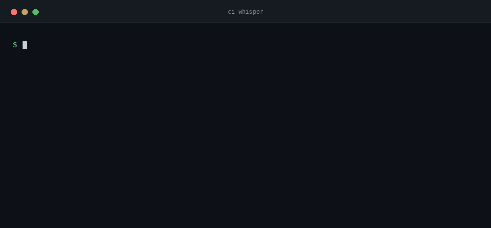

# ci-whisper

**Read a failed CI log. Get the first real error, its causal chain, and a fix.** One paragraph instead of ten thousand lines of noise.

[](https://github.com/mgkvibez/ci-whisper/actions/workflows/ci.yml)
[](LICENSE)
[](https://pypi.org/project/ci-whisper/)
[](pyproject.toml)
[](https://github.com/mgkvibez/ci-whisper/stargazers)



## Install

```bash
pipx install ci-whisper
```

Also on [PyPI](https://pypi.org/project/ci-whisper/). From source: `git clone && pip install -e ".[dev]"`.

## Four ways to use it

```bash
# 1. The one you will use daily: pipe the failing job log
gh run view --log-failed | ci-whisper

# 2. From a downloaded log file
ci-whisper --file /tmp/build.log

# 3. Let it fetch the last failed run of the current repo
ci-whisper --gh 16977481234

# machine-readable, for a bot or an agent skill
ci-whisper --file build.log --json
```

Exit code is `1` when no error signal is found, so you can gate on it.

GitHub Actions and GitLab CI logs are supported. The default `--provider auto`
detects GitLab by its section markers and otherwise uses GitHub cleaning. To
select a format explicitly, use `--provider github` or `--provider gitlab`:

```bash
ci-whisper --file gitlab-job.log --provider gitlab --json
cat gitlab-job.log | ci-whisper
```

GitLab section markers and ANSI colors are removed. Displayed section headers
are retained; marker-only lines become empty placeholders, so reported line
numbers still refer to the original log. `--gh` continues to fetch GitHub Actions
logs; download a GitLab log and use `--file` or stdin to read it.

## As an MCP server, so an agent reads the run itself

`ci-whisper-mcp` speaks MCP over stdio. An agent can then ask for a diagnosis instead of
being handed a log by a human, and it gets the same analysis the CLI prints:

```json
{
  "mcpServers": {
    "ci-whisper": {
      "command": "ci-whisper-mcp"
    }
  }
}
```

Two tools:

| Tool | What it does |
|---|---|
| `read_ci_log` | takes `log`, or `path`, plus an optional `provider`; returns the first real error, the causal chain and a fix, as text and as structured content |
| `read_github_run` | fetches a failed Actions run with `gh run view --log-failed`, then analyses it |

It declares no runtime dependencies, and it does not depend on the `mcp` package either:
the five protocol methods it needs are implemented against JSON-RPC 2.0 directly, so
`pipx install ci-whisper` gives you a working server with nothing else on the machine.

**What it does not do:** it opens no pull requests and holds no token. A diagnosis goes
back to the agent, and the agent decides what to change. Exposing your GitHub credentials
to a log parser so it can write branches would be a trade nobody asked for.

Requesting a specific protocol version is the client's job; this server reports
`2024-11-05`, the version it was built against. Verified against the official `mcp` SDK
client, not only against its own tests: handshake, `tools/list`, a real tool call with
structured content, the no-signal error path, and `ping`.

## Why it exists

A red build hands you 10k lines. The actual cause is line 4, and everything after it is consequence: retries, cascading test failures, the polite `##[error]Process completed with exit code 1`.

Two things go wrong when this hits an agent. It reads the *last* error and fixes a symptom, or it reads the header and summarises nothing. ci-whisper ranks signals so the cause outranks its own consequences, then shows the citations so anyone can check the call.

## How it works

1. **Clean** — strips ANSI and GitHub's `2026-10-29T08:01:02.1234567Z ` timestamp prefix, keeping a line-number map to the original file.
2. **Scan** — matches a ranked rule set: `ModuleNotFoundError`/`Exception` (4) beat `Traceback`, test failures and compiler errors (3), which beat `npm ERR!` and `##[error]` (2), which beat a bare `exit code 1` (1).
3. **Root cause** — highest severity, then earliest line. Noise (warnings, deprecations, `0 failed`, download progress) is filtered before ranking.
4. **Chain** — the chosen line plus the following block: indented continuations, frames, and `caused by` style links.
5. **Fix** — a rule per failure shape: peer dependency conflict, missing module, permissions, missing path, assertion, timeout, OOM.

No network calls, no LLM, no dependencies.

## Contributing

Read [CONTRIBUTING.md](CONTRIBUTING.md). Tests:

```bash
python -m pytest -q
```

## License

MIT. See [LICENSE](LICENSE).
